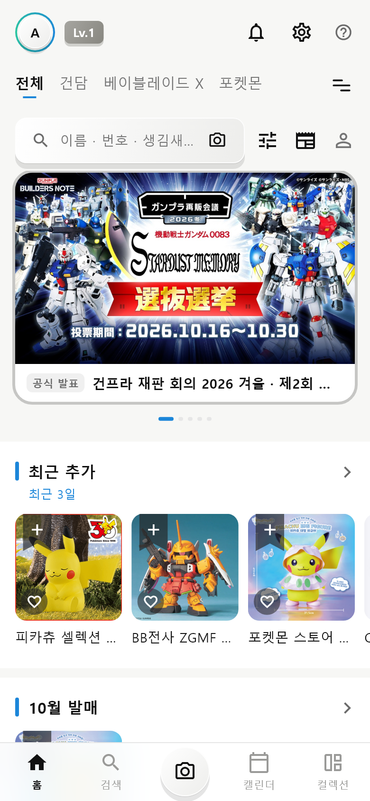
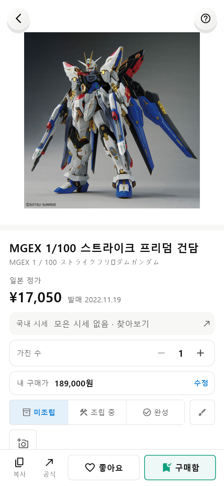
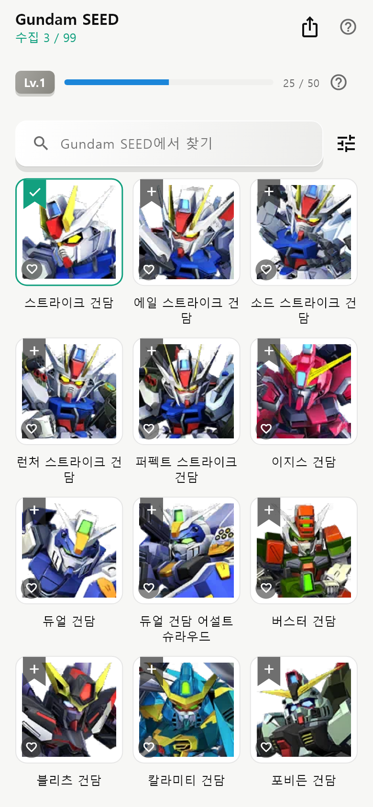
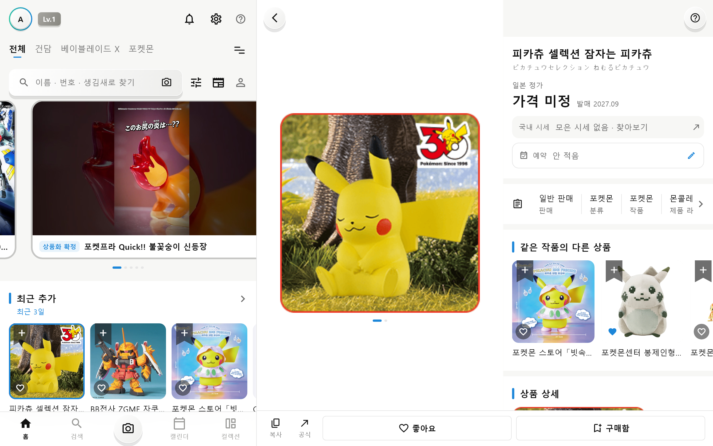

# Hobby Atlas

건프라 · 베이블레이드 X · 포켓몬 · Fate · 마법소녀 마도카☆마기카 · 아머드 코어 · 레고의 **공식 상품 · 발매일 · 새 소식**을 한곳에서 보고,
좋아요 · 구매함 · 도감으로 **내 컬렉션**을 기록하는 개인용 안드로이드 앱입니다. 둘이 같이 쓰며, 친구로 서로의 컬렉션과 사진을 봅니다.

## 무엇을 하나

| 탭 · 화면 | 하는 일 |
|---|---|
| 홈 | 내 채널의 예고 배너(공식 먼저 · 비공식 소식은 「비공식」 꼬리표) · 새 상품 · 곧 나오는 것. 사진 위에서 바로 ♡ 좋아요 · 리본 구매함 |
| 검색 | 이름 · 말로 찾기, 검색어 없을 때는 전체 / 종류 / 세대로 둘러보기, 기체별로 묶기 |
| 📷 찍어서 찾기 | 사진 · 바코드 · 공유받은 이미지로 상품 찾기 (기기 안 이미지 모델, 인터넷 없이) |
| 캘린더 | 발매일 · 예고(공식 · 비공식)를 날짜로 |
| 컬렉션 | 좋아요 · 예약 · 구매함 · 도감 — 건담 작품 · 기체, 베이 블레이더 · 부품 · 조합, 포켓몬, Fate 서번트, 마도카 캐릭터 |
| 상품 상세 | 공식 사진 · 일본 정가 · 국내 시세 · 공식 페이지 · 내 구매가 |
| 알림 | 내 채널의 새 상품 · 재판 · 발매일 변경, 직접 만든 조건(채널 · 작품 · 종류) |
| 친구 | `@아이디`로 친구 맺기, 서로의 컬렉션 · 사진 벽 보기 |

## 데이터

- 상품 데이터는 [Gunpula](https://github.com/mdefitko777/Gunpula) 저장소가 각 공식 사이트(BANDAI SPIRITS · 프리미엄 반다이 · TAMASHII NATIONS · 가샤폰 · TAKARA TOMY · Good Smile Company · 애니플렉스 · 포켓몬센터 · Rebrickable …)에서 **매일** 모아 GitHub Pages 로 내보낸 것을 앱이 받습니다 (`lib/data/catalog.dart`). 바뀐 것만 다시 받습니다.
- 내 기록(좋아요 · 구매함 · 도감 · 사진 …)은 기기에 저장되고, 로그인하면 Supabase 계정에 동기화됩니다. 동기화 규칙은 [AGENTS.md](AGENTS.md) "데이터 약속".

## 설치 · 업데이트

- APK: 이 저장소 릴리스 [`apk-latest`](https://github.com/mdefitko777/hobby-atlas-v3/releases/tag/apk-latest) (arm64). 설치한 뒤에는 앱이 새 판을 알려 주고 그 자리에서 받습니다.
- `main` 에 푸시하면 GitHub Actions(`.github/workflows/android-apk.yml`)가 둘 중 하나로 보냅니다 ([AGENTS.md](AGENTS.md) "릴리스와 패치").
  - 다트 코드(`lib/`)만 바뀌었으면 **패치**(Shorebird 코드 푸시): 새로 설치하지 않고, 앱이 뒤에서 받아 다음에 열 때 적용합니다.
  - 네이티브 · 플러그인 · 자산 · `pubspec` 이 바뀌었으면 서명된 **새 APK** `1.1.<실행 번호>`. 커밋 제목에 `[minor]` 가 있으면 업데이트 알림을 띄우지 않습니다.
- 위험한 변경(네이티브 · 플러그인)은 다른 가지에 올려 `gh workflow run android-apk.yml --ref <가지>` 로 시험 빌드만 해 봅니다 (릴리스 · Shorebird 는 건드리지 않음).

## 개발

```bash
flutter pub get
dart analyze lib test tool     # 경로에 한글이 있으면 flutter analyze 가 멈춘다 → dart analyze
flutter test                   # 진짜 서버에 닿지 않는다 (test/support/fake_backend.dart)
```

- `flutter test` 도 한글 경로에서 멈출 수 있어, 영문 경로의 worktree 에서 돌립니다.
- 웹 미리보기(`flutter run -d chrome`)에서는 공식 사이트 사진이 CORS 로 안 보입니다 — 폰에서는 보입니다.
- 서명 키는 저장소 밖, GitHub Actions secrets 에만 있습니다.
- Supabase SQL 은 `docs/supabase-v3-*.sql` — 돌리는 순서는 AGENTS.md.

## 폴더

```
lib/
├── data/       받기 · 캐시 · 파싱 · 저장 (catalog · gunpula · user_store …)
├── logic/      규칙 — 순수 Dart (찾기 · 필터 · 레벨 · 베이 조합 …)
├── sync/       계정 · 동기화 · 친구 · 사진 공유 (Supabase)
├── notifications/ · background/   알림 규칙 · 백그라운드 확인
├── widgets/    공용 조각 (화면은 lib/widgets.dart 하나만 import)
└── screens/    화면 (a_ 홈 … w_ 첫 실행) — 파일 맨 위에 요소 번호 대응표
test/           테스트 (test/fixtures/sample-db.json = 화면 테스트용 예시 데이터)
tool/           스크린샷 · 디자인 가이드 · 앱 아이콘 만들기
docs/           디자인 가이드 · Supabase SQL · 스크린샷
```

## 문서

- [AGENTS.md](AGENTS.md) — 구조 · 데이터 약속 · 비밀 · 작업 방식 (AI 와 같이 작업할 때의 규칙)
- [docs/디자인가이드.md](docs/디자인가이드.md) — 화면 목록 · 요소 번호(코드 주석 `// D-6 P03` 과 같은 번호) · 디자인 규칙. `python tool/make_guide.py .` 로 다시 만듭니다
- 스크린샷: `flutter test tool/screenshots_test.dart` → `docs/screenshots/`

| 홈 | 상품 상세 | 도감 | 넓은 화면 |
|---|---|---|---|
|  |  |  |  |
